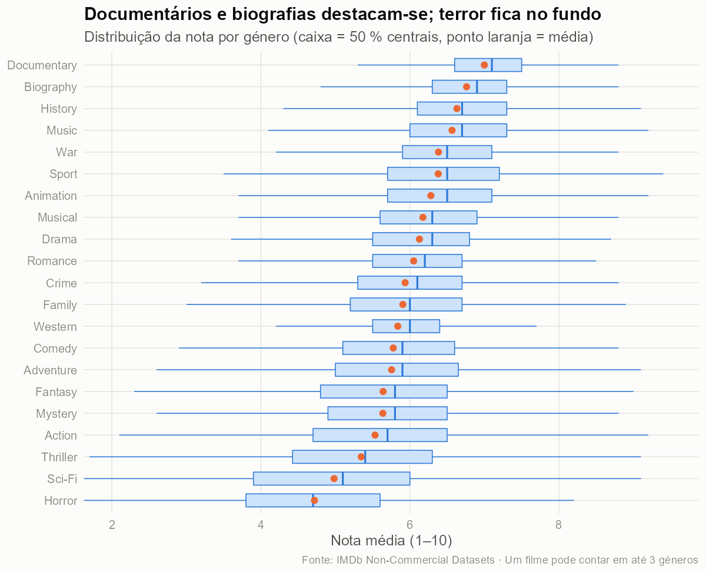
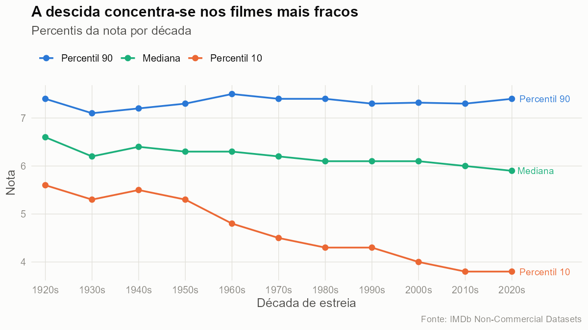
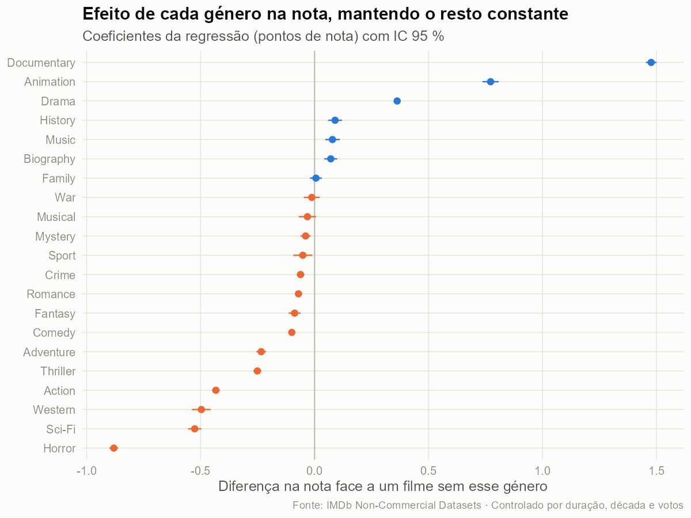
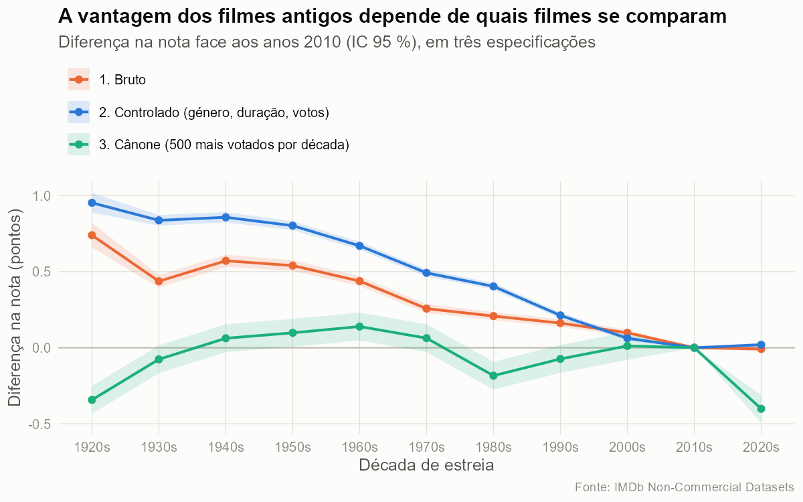
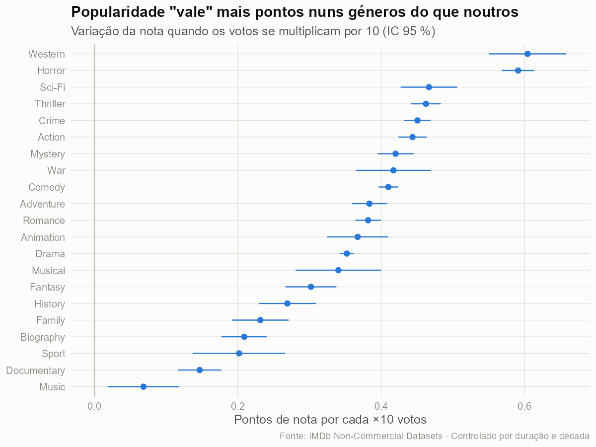
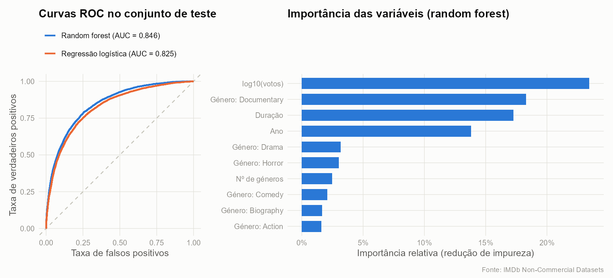

```{r}
#| include: false
library(dplyr)
library(knitr)
num <- function(x, d = 2) formatC(x, format = "f", digits = d, decimal.mark = ",")
fmt <- function(x) format(round(x), big.mark = " ")
funil <- readRDS("resultados/funil.rds")
meta  <- readRDS("resultados/meta.rds")
res   <- readRDS("resultados/modelos.rds")
m5    <- res$p5_metricas
```

## A pergunta de partida

::: {.columns}
::: {.column width="55%"}
* O IMDb é a minha referência para escolher o que ver.
* Mas um **8 num filme de terror** vale o mesmo que um **8 num drama**?
* E os clássicos são mesmo melhores, ou só os bons sobrevivem na memória?
:::
::: {.column width="45%"}
::: {.destaque}
A nota de um filme reflete a sua **qualidade**, ou depende do **género**, da **duração**, da **época** e da **popularidade**?
:::
:::
:::

## Os dados: IMDb Non-Commercial Datasets

::: {.columns}
::: {.column width="50%"}
* 4 ficheiros TSV públicos, juntos por `tconst` / `nconst`
  * `title.basics` · `title.ratings` · `title.crew` · `name.basics`
* Descarregados **pelo próprio código**, com *snapshot* de `r format(meta$data_snapshot, "%d/%m/%Y")`
* Licença não comercial → no Git fica o código, não os dados
:::
::: {.column width="50%"}
::: {.numero}
`r fmt(funil$n[1])`
:::
::: {.legenda}
títulos no ficheiro original
:::
::: {.numero .azul}
`r fmt(tail(funil$n, 1))`
:::
::: {.legenda}
longas-metragens após limpeza
:::
:::
:::

## Preparação: cada corte tem uma razão

```{r}
passos <- tibble::tribble(
  ~Problema, ~Decisão, ~Porquê,
  "12,9 M títulos de todos os tipos", "só `movie`", "episódios, curtas e vídeos têm outros votantes",
  "Conteúdo adulto", "excluir", "população e lógica de votação diferentes",
  "Filmes sem nota", "*join* com `title.ratings`", "sem variável resposta",
  "Antes de 1920 e ano de 2026", "**1920–2025**", "poucos votos / votos ainda a acumular",
  "Médias de 3 ou 10 votos", "**≥ 100 votos**", "erro-padrão da média ≈ 0,2 pontos",
  "`\\N` na duração ou géneros", "remover", "após o filtro de votos só falta ≈ 1 %",
  "Durações de 1 a 51 420 min", "**40–300 min**", "definição de longa-metragem (AMPAS/BFI)"
)
passos |>
  mutate(`Filmes restantes` = fmt(funil$n[-1])) |>
  kable(align = "lllr")
```

::: {.transformacoes}
**Transformações:** `"Comedy,Drama,Romance"` → **21 variáveis 0/1** (a ordem é alfabética, não há género principal) · votos → **`log10(votos)`** (assimetria 18,8 → quase simétrica) · realizador via `title.crew` + `name.basics` · década e idade derivadas do ano
:::

## Cinco perguntas

1. **Fatores:** que fatores explicam a nota, e com que peso? *(regressão linear múltipla)*
2. **Sobrevivência:** os filmes antigos são melhores ou é viés de sobrevivência? *(3 especificações)*
3. **Popularidade × género:** a relação votos–nota é igual em todos os géneros? *(interação + teste F)*
4. **Realizador:** quanto da nota se deve a quem realizou? *(modelo misto, ICC)*
5. **Previsão:** dá para prever se um filme terá nota ≥ 7? *(logística vs. random forest)*

## O género separa muito as notas

{fig-align="center" height="600"}

## Uma pista: o topo não mudou em 100 anos

{fig-align="center" height="520"}

::: {.nota-rodape}
Os melhores filmes de cada época têm a mesma nota (P90 ≈ 7,3). O que cai é a **cauda de baixo**.
:::

## P1 · O género é o fator dominante

::: {.columns}
::: {.column width="62%"}
{height="560"}
:::
::: {.column width="38%"}
**R² = `r num(res$p1_r2, 2)`**

Perda de R² sem cada bloco:

```{r}
res$p1_importancia |>
  transmute(Bloco = bloco, `ΔR²` = paste0(num(100 * delta_r2, 1), " p.p.")) |> kable()
```

`r num(100 * (1 - res$p1_r2), 0)` % **fica por explicar**, e aí cabe a "qualidade" que os dados não medem.
:::
:::

## P2 · Os clássicos eram melhores?

{fig-align="center" height="520"}

::: {.nota-rodape}
Entre os **500 mais votados de cada década**, a vantagem dos antigos **desaparece** → **viés de sobrevivência**.
:::

## P3 · A popularidade "vale" mais nuns géneros

::: {.columns}
::: {.column width="58%"}
{height="560"}
:::
::: {.column width="42%"}
Interação votos × género: **F = `r num(res$p3_teste$statistic[2], 1)`, p < 0,001**

* **Western, terror, ficção científica:** muitos filmes baratos e mal avaliados; os que chegam ao grande público são os bons.
* **Música, documentário:** um público de nicho e interessado dá notas altas mesmo com poucos votos.
:::
:::

## P4 · O realizador pesa mais do que tudo o resto

::: {.columns}
::: {.column width="45%"}
::: {.numero .azul}
`r num(100 * res$p4$icc_controlado, 0)` %
:::
::: {.legenda}
da variância da nota está **entre realizadores**, mesmo depois de controlar género, duração, década e votos (ICC)
:::

`r fmt(res$p4$n_filmes)` filmes · `r fmt(res$p4$n_realizadores)` realizadores (≥ 3 filmes)
:::
::: {.column width="55%"}
```{r}
res$p4_top_conhecidos |> head(8) |>
  transmute(Realizador = realizador, Filmes = realizador_n_filmes,
            `Efeito (pontos)` = paste0("+", num(efeito))) |> kable()
```
::: {.pequeno}
O topo absoluto é de realizadores de nicho com poucas centenas de votos, o que pode indicar votação organizada.
:::
:::
:::

## P5 · Prever um filme "bom" (nota ≥ 7)

{fig-align="center" height="430"}

```{r}
m5 |> transmute(Modelo = modelo, AUC = num(auc, 3), Accuracy = num(accuracy, 3),
                Sensibilidade = num(sensibilidade, 2)) |> kable()
```

## Conclusões

```{r}
#| include: false
canone_20 <- res$p2$estimate[startsWith(res$p2$modelo, "3.") & res$p2$decada == 1920]
bruto_20  <- res$p2$estimate[startsWith(res$p2$modelo, "1.") & res$p2$decada == 1920]
razao_declives <- max(res$p3_declives$estimate) / min(res$p3_declives$estimate)
```

::: {.cartoes}
::: {.cartao}
[P1 · Fatores]{.etiqueta}
[`r num(100 * res$p1_importancia$delta_r2[1], 0)` p.p.]{.valor}
dos `r num(100 * res$p1_r2, 0)` % de R² vêm do **género**. Documentary +1,5 e Horror −0,9 pontos. **`r num(100 * (1 - res$p1_r2), 0)` % fica por explicar.**
:::
::: {.cartao}
[P2 · Época]{.etiqueta}
[`r sub(".", ",", sprintf("%+.1f", bruto_20), fixed = TRUE)` → `r sub("-", "−", sub(".", ",", sprintf("%+.1f", canone_20), fixed = TRUE))`]{.valor}
anos 20 vs. 2010: em bruto vs. no **cânone**. A vantagem dos clássicos é **viés de sobrevivência**.
:::
::: {.cartao}
[P3 · Votos × género]{.etiqueta}
[`r round(razao_declives)`×]{.valor}
diferença no "valor" da popularidade entre géneros. Pesa mais em **western e terror**, menos em **documentário e música**.
:::
::: {.cartao}
[P4 · Realizador]{.etiqueta}
[`r num(100 * res$p4$icc_controlado, 0)` %]{.valor}
da variância está **entre realizadores**, mesmo depois de controlar género, duração, década e votos.
:::
::: {.cartao}
[P5 · Previsão]{.etiqueta}
[AUC `r num(m5$auc[3], 2)`]{.valor}
o *random forest* discrimina bem, mas com limiar 0,5 deteta só `r num(100 * m5$sensibilidade[3], 0)` % dos filmes ≥ 7.
:::
:::

::: {.destaque}
A nota do IMDb é útil, mas **não é comparável entre géneros nem entre épocas**.
:::

## Limitações

* **Quem vota no IMDb ≠ público em geral:** a amostra é autosselecionada e a nota mede o entusiasmo de quem decide votar.
* **Possível manipulação de votos:** realizadores de nicho com notas perto de 9 e poucas centenas de votos.
* **Associação, não causalidade:** nenhum modelo diz que alongar um filme *causa* melhor nota.
* **Snapshot de uma data:** os filmes dos anos 2020 ainda estão a acumular votos.
* **Escolhas de limpeza:** o limiar de 100 votos e o intervalo de 40–300 min são decisões justificadas, mas não únicas.
* **Crítica vs. público:** o IMDb não publica notas da crítica, por isso esta comparação ficou de fora.

## Obrigado {.center}

**Repositório:** <https://github.com/FredericoSoliz/ssa-imdb>

::: {.pequeno}
R · Quarto · data.table · dplyr · ggplot2 · lme4 · ranger · pROC
:::
