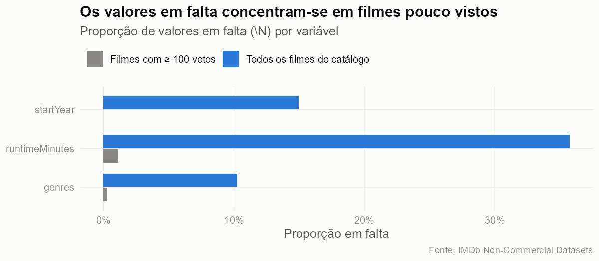
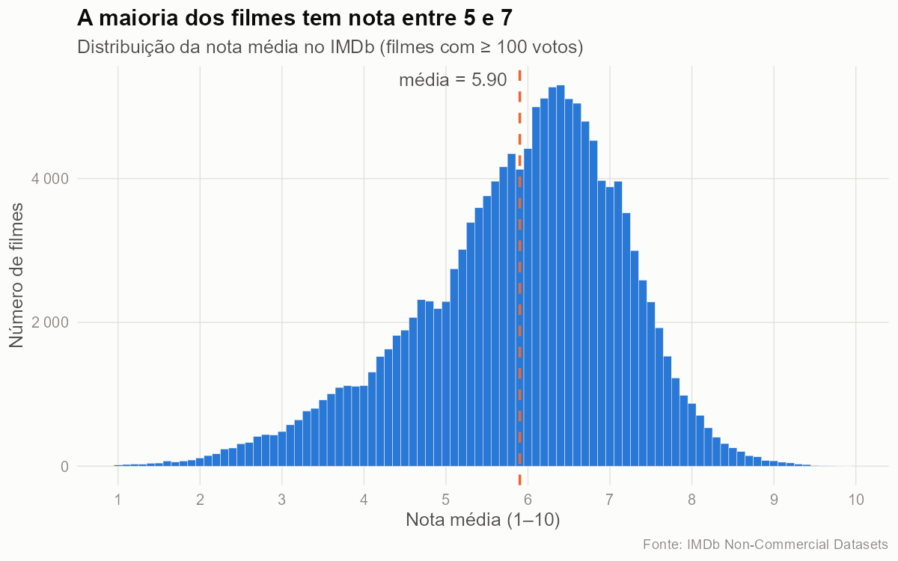
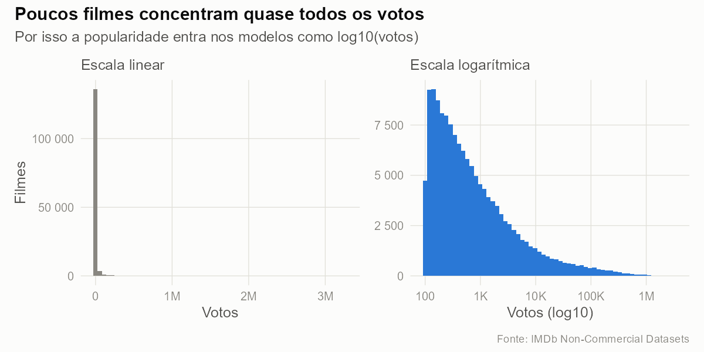
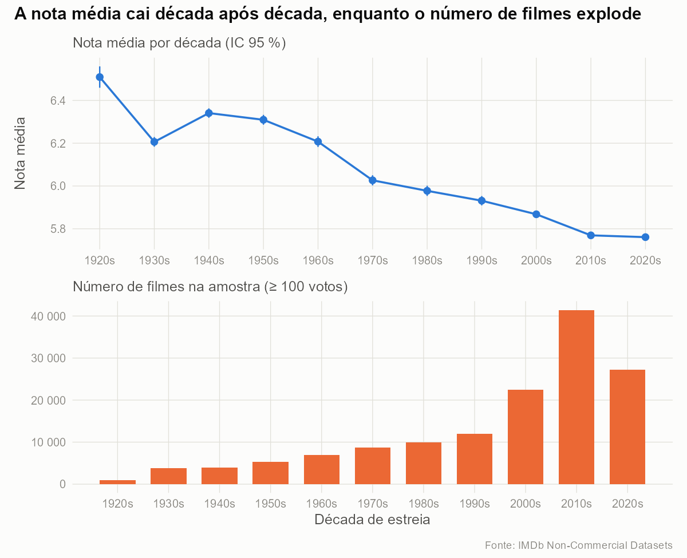
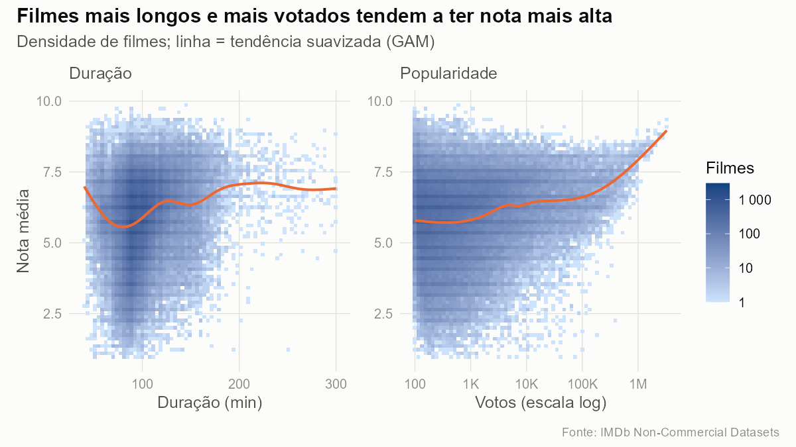
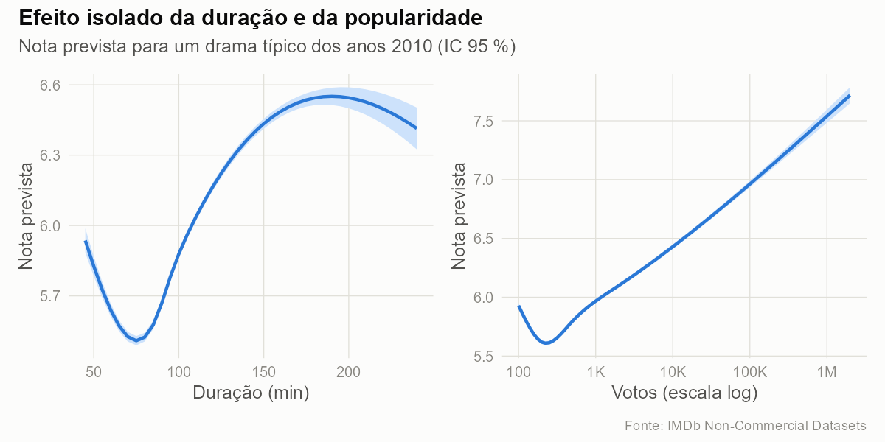
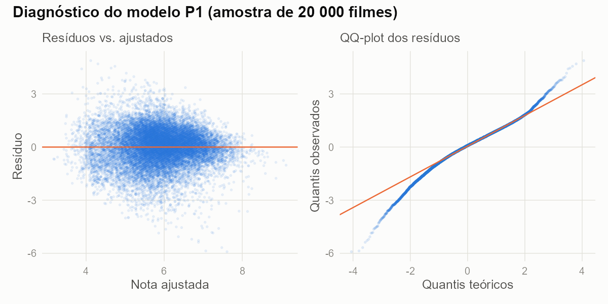
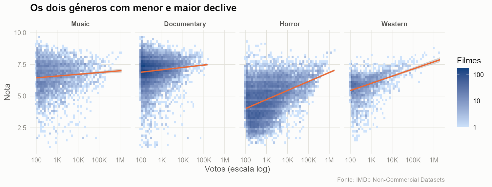
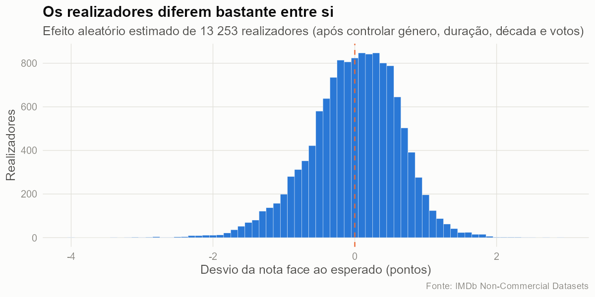

```{r}
#| label: setup
#| include: false
library(dplyr)
library(knitr)
fmt <- function(x, d = 0) format(round(x, d), big.mark = " ", decimal.mark = ",", nsmall = d)
num <- function(x, d = 2) formatC(x, format = "f", digits = d, decimal.mark = ",")

meta   <- readRDS("resultados/meta.rds")
funil  <- readRDS("resultados/funil.rds")
dic    <- readRDS("resultados/dicionario.rds")
desc   <- readRDS("resultados/descritiva.rds")
dec    <- readRDS("resultados/por_decada.rds")
gen    <- readRDS("resultados/por_genero.rds")
om     <- readRDS("resultados/omissos.rds")
res    <- readRDS("resultados/modelos.rds")

n_final <- tail(funil$n, 1)
p2 <- res$p2
p2v <- function(modelo_prefixo, d) p2$estimate[startsWith(p2$modelo, modelo_prefixo) & p2$decada == d]
coef_g <- function(g) res$p1_generos$estimate[res$p1_generos$genero == g]
p3 <- res$p3_teste[2, ]
m5 <- res$p5_metricas
```

**Contexto:** projeto integrador da unidade curricular de Seminário de Sistemas e Aplicações (2026/27). Corresponde aos momentos de avaliação M2 (problema e dados), M3 (preparação e EDA) e M4 (modelação e resultados).

**Repositório Git:** <https://github.com/FredericoSoliz/ssa-imdb>

# Resumo executivo {.unnumbered}

Este trabalho investiga se a nota média de um filme no IMDb reflete a sua qualidade ou se depende de fatores estruturais como o género, a duração, a época e a popularidade. A partir dos ficheiros públicos do IMDb (`r fmt(funil$n[1])` títulos), construímos um conjunto limpo de `r fmt(n_final)` longas-metragens com pelo menos 100 votos e respondemos a cinco perguntas com regressão linear, modelos mistos e classificação supervisionada. **O género é, de longe, o fator mais associado à nota** (sozinho explica `r num(100 * res$p1_importancia$delta_r2[1], 0)` pontos percentuais dos `r num(100 * res$p1_r2, 0)` % de variância explicada). Documentários e animação partem com vantagem, terror e ficção científica com desvantagem. **A ideia de que "os filmes antigos eram melhores" é sobretudo um viés de sobrevivência:** comparando apenas os 500 filmes mais votados de cada década, a vantagem das décadas antigas desaparece. O realizador explica cerca de metade da variância da nota, e um modelo *random forest* prevê se um filme terá nota ≥ 7 com AUC de `r num(m5$auc[3], 2)`.

# Introdução

## Motivação

O cinema é um dos meus principais *hobbies* e o IMDb é a referência que uso para escolher o que ver. Muitas vezes, porém, a nota não corresponde à minha opinião, e um 8 num filme de terror não parece "valer" o mesmo que um 8 num drama. Daqui surgiu a pergunta de partida:

> **A nota de um filme reflete a sua qualidade, ou depende de fatores como o género, a duração, a época e a popularidade?**

A resposta interessa a quem usa estas notas para decidir (espectadores, plataformas de *streaming*, sistemas de recomendação), que precisa de saber que comparações são justas.

## Perguntas de investigação

| | Pergunta | Método |
|---|---|---|
| **P1** | Que fatores (género, duração, década, popularidade) explicam a nota média de um filme, e com que peso? | Regressão linear múltipla com *splines* |
| **P2** | Os filmes antigos têm melhor nota por serem melhores, ou por **viés de sobrevivência**? | Comparação do efeito da década em três especificações |
| **P3** | A relação entre popularidade (votos) e nota é igual em todos os géneros? | Regressão com interação + teste F |
| **P4** | Quanto da nota se deve ao realizador, para além das características do filme? | Modelo linear misto, ICC |
| **P5** | É possível prever se um filme terá nota ≥ 7 a partir das suas características? | Regressão logística vs. *random forest* |

Face ao M1, as três perguntas iniciais foram mantidas e reformuladas para serem testáveis. Acrescentaram-se a P4 (que exigiu juntar mais duas tabelas, `title.crew` e `name.basics`) e a P5 (avaliação preditiva com métricas fora da amostra). A comparação entre a nota do público e a da crítica, referida na motivação do M1, **não** é possível com estes dados, porque o IMDb não publica notas da crítica. Passou por isso para trabalho futuro.

# Metodologia e dados

## Origem dos dados

Os dados vêm dos [IMDb Non-Commercial Datasets](https://developer.imdb.com/non-commercial-datasets/): ficheiros TSV públicos, atualizados diariamente. Este relatório usa o *snapshot* de **`r format(meta$data_snapshot, "%d/%m/%Y")`**. Como a licença é não comercial, os dados não estão no repositório: o notebook `01_preparacao.qmd` descarrega-os por URL, o que torna a análise reprodutível.

| Ficheiro | Linhas (aprox.) | Uso |
|---|---|---|
| `title.basics` | 12,9 M | tipo, ano, duração, géneros |
| `title.ratings` | 1,6 M | nota média, número de votos |
| `title.crew` | 12,9 M | realizadores |
| `name.basics` | 15 M | nomes dos realizadores |

## Pipeline reprodutível

A análise está dividida em três notebooks Quarto, executados por ordem pelo `_quarto.yml`. Todos usam caminhos relativos à raiz do projeto:

1. `01_preparacao.qmd`: download, importação, limpeza, transformação e dicionário de dados;
2. `02_exploracao.qmd`: estatística descritiva e visualizações;
3. `03_modelacao.qmd`: modelos das cinco perguntas.

Este relatório e a apresentação reutilizam os objetos gravados em `resultados/` e as figuras em `figuras/`. Para reproduzir tudo basta correr `quarto render` na raiz do projeto.

## Limpeza e transformação

Os dados exigiram preparação real: valores em falta codificados como `\N`, números guardados como texto, aspas não balanceadas nos títulos, até três géneros numa só célula e *outliers* de duração (de 1 minuto a mais de 50 000). A tabela seguinte mostra o efeito de cada decisão.

```{r}
#| label: tbl-funil
#| tbl-cap: "Funil de limpeza: filmes restantes após cada passo"
kable(funil |> mutate(n = fmt(n)), col.names = c("Passo", "Filmes"), align = "lr")
```

| Decisão | Justificação |
|---|---|
| Apenas `movie`, sem conteúdo adulto | Episódios, curtas e telefilmes têm públicos e lógicas de votação diferentes |
| 1920–2025 | Antes de 1920 há muito poucos filmes votados; em 2026 os filmes ainda estão a acumular votos |
| ≥ 100 votos | A média de poucos votos é dominada pelo acaso; com 100 votos o erro-padrão da média fica em ≈ 0,2 pontos |
| Remover duração/género em falta | No conjunto votado faltam em apenas ≈ 1 % dos filmes ([Figura @fig-omissos]); imputar acrescentaria ruído sem benefício |
| Duração entre 40 e 300 min | 40 min é a definição de longa-metragem (AMPAS/BFI). O critério IQR (1,5×) cortaria filmes normais acima de `r round(meta$limites_iqr[2])` min, por isso usou-se um critério de domínio |
| Géneros → 21 variáveis binárias | O IMDb ordena os géneros alfabeticamente, por isso o "primeiro género" não é o principal |
| `log10(votos)` | Os votos têm assimetria `r num(desc$assimetria[desc$variavel == "votos"], 1)`; em escala log ficam quase simétricos |

{#fig-omissos width=85%}

Os valores em falta não são aleatórios: concentram-se em filmes obscuros. Exigir um mínimo de votos resolve quase todo o problema, e a remoção dos restantes casos não enviesa a amostra de forma relevante.

## Dicionário de dados

```{r}
#| label: tbl-dicionario
#| tbl-cap: "Dicionário de dados do conjunto final (também em docs/dicionario_dados.csv)"
kable(dic, col.names = c("Variável", "Tipo", "Descrição", "Valores", "% NA", "Origem"))
```

# Análise exploratória

```{r}
#| label: tbl-descritiva
#| tbl-cap: "Estatística descritiva das variáveis numéricas"
desc |> select(variavel, media, dp, min, q1, mediana, q3, max, assimetria) |>
  kable(digits = 2, format.args = list(big.mark = " "),
        col.names = c("Variável", "Média", "DP", "Mín", "Q1", "Mediana", "Q3", "Máx", "Assimetria"))
```

{#fig-nota width=85%}

A nota média é `r num(desc$media[1])` (mediana `r num(desc$mediana[1], 1)`), com assimetria negativa: há uma cauda de filmes muito mal avaliados ([Figura @fig-nota]).

{#fig-votos width=95%}

A popularidade é extremamente desigual. A mediana é de `r fmt(desc$mediana[2])` votos, mas há filmes com mais de 3 milhões ([Figura @fig-votos]). Estes casos não são erros a remover: são o fenómeno que queremos estudar. Por isso usa-se `log10(votos)`.

{#fig-genero width=90%}

O género é o fator que mais separa as notas ([Figura @fig-genero]). Os documentários têm média de `r num(gen$media[gen$genero == "Documentary"])`, contra `r num(gen$media[gen$genero == "Horror"])` no terror.

{#fig-decada width=85%}

A nota média desce de forma quase contínua ao longo das décadas, ao mesmo tempo que o número de filmes avaliados se multiplica ([Figura @fig-decada]).

{#fig-quantis width=85%}

A [Figura @fig-quantis] dá a primeira pista para a P2: **o percentil 90 é praticamente constante (≈ 7,3) ao longo de cem anos**, enquanto o percentil 10 cai de 5,6 para 3,8. Os melhores filmes de cada época são avaliados de forma semelhante. O que mudou é que hoje entram na amostra muitos mais filmes fracos.

{#fig-relacoes width=95%}

As relações com a duração e com os votos são claramente não lineares ([Figura @fig-relacoes]). Por isso estas variáveis entram nos modelos com *splines* naturais em vez de termos lineares.

# Modelação e resultados

## P1 — Que fatores explicam a nota?

O modelo de regressão linear múltipla (géneros + *spline* da duração + década + *spline* de log₁₀ votos) explica **R² = `r num(res$p1_r2, 3)`** da variância da nota. Para medir o peso de cada fator, retirou-se cada bloco de variáveis e mediu-se quanto R² o modelo perde:

```{r}
#| label: tbl-p1
#| tbl-cap: "Importância de cada bloco: perda de R² quando é retirado do modelo"
res$p1_importancia |> mutate(delta_r2 = paste0(num(100 * delta_r2, 1), " p.p.")) |>
  select(bloco, delta_r2) |> kable(col.names = c("Bloco", "Perda de R²"), align = "lr")
```

{#fig-p1 width=85%}

* **O género domina:** retirá-lo faz cair o R² em `r num(100 * res$p1_importancia$delta_r2[1], 0)` p.p. Com tudo o resto igual, ser documentário acrescenta `r num(coef_g("Documentary"))` pontos e ser animação `r num(coef_g("Animation"))`. Ser terror retira `r num(abs(coef_g("Horror")))` e ficção científica `r num(abs(coef_g("Sci-Fi")))` ([Figura @fig-p1]).
* **Popularidade, década e duração** contribuem cada uma com 3–6 p.p. A relação com os votos é plana até ~10 mil e depois sobe ([Figura @fig-p1-curvas]).
* **`r num(100 * (1 - res$p1_r2), 0)` % da variância fica por explicar.** Esta é uma conclusão importante: as características observáveis não determinam a nota, e há espaço para "qualidade" no sentido do argumento, da realização e da interpretação, que estes dados não medem.

{#fig-p1-curvas width=90%}

{#fig-diag width=90%}

**Diagnóstico ([Figura @fig-diag]):** os resíduos não mostram padrão face aos valores ajustados, mas a cauda esquerda é mais pesada do que a normal. Com n > 140 mil, a inferência sobre os coeficientes continua válida, mas previsões individuais de notas muito baixas seriam pouco fiáveis.

## P2 — Os filmes antigos são melhores ou é viés de sobrevivência?

{#fig-p2 width=90%}

* **Em bruto**, um filme dos anos 20 tem mais `r num(p2v("1.", 1920))` pontos do que um dos anos 2010.
* **Controlando** género, duração e votos, a vantagem até **aumenta** (`r num(p2v("2.", 1920))` pontos). A diferença não se explica, portanto, por os filmes antigos terem outro perfil de género, duração ou popularidade.
* **No cânone** (os 500 filmes mais votados de cada década), a vantagem **desaparece**: as diferenças ficam entre `r num(min(p2$estimate[startsWith(p2$modelo, "3.") & p2$decada < 2020]))` e `r num(max(p2$estimate[startsWith(p2$modelo, "3.")]))` pontos, sem tendência. Os anos 20 ficam até abaixo dos 2010.

**Resposta:** os filmes antigos **não** são intrinsecamente melhor avaliados. Quando se comparam conjuntos equivalentes, ou seja, os filmes que cada época deixou na memória do público, as notas são semelhantes. A vantagem aparente resulta de o catálogo antigo já ser uma seleção (o que foi preservado e continua a ser visto), enquanto as décadas recentes incluem toda a produção, boa e má. É o viés de sobrevivência, e é consistente com a estabilidade do percentil 90 na [Figura @fig-quantis].

A queda do cânone dos anos 2020 (`r num(p2v("3.", 2020))`) tem outra explicação: são filmes com menos de 6 anos e ainda a acumular votos. O 500.º filme mais votado dos anos 2020 tem `r fmt(res$p2_canone$votos_min[11])` votos, contra `r fmt(res$p2_canone$votos_min[10])` nos anos 2010, e o seu cânone ainda não está formado.

## P3 — A relação popularidade–nota é igual em todos os géneros?

A interação `log10(votos) × género` é estatisticamente significativa (**F(`r p3$df`, `r fmt(p3$df.residual)`) = `r num(p3$statistic, 1)`, p < 0,001**). A relação **não** é igual entre géneros.

{#fig-p3 width=85%}

{#fig-p3-fac width=100%}

* Em todos os géneros, mais votos estão associados a nota mais alta, mas a intensidade varia quase 10 vezes ([Figura @fig-p3]).
* **Western, terror e ficção científica** são os géneros em que a popularidade "vale" mais (≈ +0,5–0,6 pontos por cada ×10 votos). Nestes géneros há uma grande massa de produções baratas e pouco vistas, com notas baixas, e os poucos títulos que furam para o grande público são os bem conseguidos.
* **Música e documentário** têm os declives mais baixos: mesmo filmes pouco vistos têm notas altas, porque são avaliados por um público de nicho, interessado no tema ([Figura @fig-p3-fac]).

**Resposta:** popularidade e qualidade percebida andam juntas, mas de forma diferente consoante o género. Comparar notas entre géneros sem ter isto em conta é enganador.

## P4 — Quanto da nota se deve ao realizador?

Restringindo a realizadores com ≥ 3 filmes (`r fmt(res$p4$n_filmes)` filmes de `r fmt(res$p4$n_realizadores)` realizadores), o modelo misto dá:

* **ICC sem preditores = `r num(res$p4$icc_nulo)`**: `r num(100 * res$p4$icc_nulo, 0)` % da variância da nota está entre realizadores;
* **ICC após controlar género, duração, década e votos = `r num(res$p4$icc_controlado)`**: metade da variância residual continua a dever-se ao realizador;
* o modelo misto é muito melhor do que o de efeitos fixos (AIC `r fmt(res$p4$aic_misto)` vs. `r fmt(res$p4$aic_fixos)`).

{#fig-p4 width=85%}

```{r}
#| label: tbl-p4
#| tbl-cap: "Realizadores amplamente vistos (mediana ≥ 20 mil votos, ≥ 8 filmes) com maior efeito positivo"
res$p4_top_conhecidos |>
  transmute(Realizador = realizador, Filmes = realizador_n_filmes,
            `Votos (mediana)` = fmt(votos_mediana), `Efeito (pontos)` = num(efeito)) |> kable()
```

**Resposta:** o realizador é o fator individual mais forte de todos. Saber quem realizou um filme diz mais sobre a nota do que o género, a duração e a época juntos. É aqui que se aproxima a ideia de "qualidade". Uma ressalva: o topo absoluto do ranking é ocupado por realizadores de nicho (poucas centenas de votos por filme e notas consistentemente perto de 9), o que sugere comunidades pequenas e muito leais, ou mesmo votação organizada. Os efeitos são *shrunk* (BLUP) para a média, o que atenua mas não elimina este problema.

## P5 — É possível prever se um filme terá nota ≥ 7?

`r num(100 * res$p5_prop_bom, 1)` % dos filmes têm nota ≥ 7. Dividiram-se os dados em treino (80 %) e teste (20 %) e compararam-se dois modelos com um modelo de referência que prevê sempre "não":

```{r}
#| label: tbl-p5
#| tbl-cap: "Desempenho no conjunto de teste (limiar de classificação 0,5)"
m5 |> kable(digits = 3, col.names = c("Modelo", "AUC", "Accuracy", "Sensibilidade", "Especificidade"))
```

{#fig-p5 width=100%}

* Os dois modelos discriminam bem (AUC `r num(m5$auc[2], 3)` e `r num(m5$auc[3], 3)`). O *random forest* ganha por pouco, o que indica que as interações que capta (como as da P3) acrescentam algum poder preditivo.
* A *accuracy* só melhora `r num(100 * (m5$accuracy[3] - m5$accuracy[1]), 1)` p.p. face à referência, porque as classes estão desequilibradas (80/20). A **sensibilidade é baixa** (`r num(m5$sensibilidade[3], 2)`): com o limiar 0,5, o modelo deixa escapar mais de metade dos filmes bons. Para uma aplicação de recomendação, baixar o limiar trocaria especificidade por sensibilidade.
* As variáveis mais importantes são os votos, ser documentário, a duração e o ano ([Figura @fig-p5]), o que confirma os resultados de P1–P3.

**Resposta:** sim, com poder discriminante razoável (AUC ≈ 0,85), mas longe da perfeição. Isto bate com a P1: as características observáveis explicam parte da nota, não a nota toda.

# Conclusões e limitações dos dados

## Respostas às perguntas

| | Resposta curta |
|---|---|
| **P1** | O **género** é o fator dominante (Documentary +1,5, Horror −0,9 pontos). Duração, década e votos têm efeitos menores e não lineares. 62 % da variância fica por explicar. |
| **P2** | **Viés de sobrevivência.** A vantagem dos filmes antigos desaparece quando se comparam os filmes mais vistos de cada década. |
| **P3** | **Não é igual.** A popularidade pesa mais em western, terror e ficção científica e menos em documentários e música. |
| **P4** | **Muito.** O realizador explica ~50 % da variância, mesmo depois de controlar as características do filme. |
| **P5** | **Parcialmente.** AUC ≈ 0,85, mas baixa sensibilidade na deteção de filmes bons. |

**Mensagem principal:** a nota do IMDb é um sinal útil, mas **não é comparável entre géneros nem entre épocas**. Um 7 num filme de terror é relativamente mais raro (e mais meritório) do que um 7 num documentário, e um clássico dos anos 40 com 7,5 não é "melhor" do que um filme atual com a mesma nota: só sobreviveu a uma seleção mais exigente.

## Enviesamentos e limitações dos dados

* **Quem vota não é o público em geral.** Os utilizadores do IMDb são uma amostra autosselecionada (mais jovem, mais masculina, mais anglófona) e a nota mede o entusiasmo de quem decide votar.
* **Possível manipulação de votos**, visível nos realizadores de nicho com notas extremas (P4).
* **Associação ≠ causalidade.** Nenhum dos modelos permite dizer que tornar um filme mais longo *causa* uma nota maior.
* **Géneros atribuídos pelo IMDb**, até 3 por filme, por ordem alfabética, sem indicação de género dominante.
* **Snapshot de uma data:** os votos de filmes recentes ainda estão a mudar, o que afeta a década de 2020.
* **Limiar de 100 votos:** é uma escolha. Valores mais altos aumentariam a fiabilidade da nota, mas enviesariam ainda mais a amostra para filmes populares.

# Limitações e trabalho futuro

**Dificuldades encontradas:** o volume dos ficheiros (≈ 13 milhões de linhas) obrigou a ler só as colunas necessárias e a filtrar logo na importação. As aspas não balanceadas nos títulos partiam a leitura até se desligar o `quote`. E os coeficientes de variáveis lógicas no R (`g_DramaTRUE`) exigiram cuidado ao extrair resultados.

**Trabalho futuro:**

* **Crítica vs. público**, a motivação original: cruzar com notas da crítica (Metacritic/Rotten Tomatoes), se houver uma fonte aberta e com licença compatível;
* **Validação temporal na P5:** treinar em filmes até 2015 e testar nos posteriores, em vez de uma divisão aleatória;
* **Sensibilidade ao limiar de votos:** repetir a análise com 1 000 e 10 000 votos;
* **Mais variáveis:** país e língua de origem (`title.akas`), elenco (`title.principals`) e orçamento;
* **Aplicação:** uma "nota ajustada" que corrija o efeito do género e da época, para comparações mais justas num sistema de recomendação.

# Uso de inteligência artificial {.unnumbered}

De acordo com as regras da unidade curricular, declara-se que foi usado um assistente de IA (Claude) como auxiliar na estruturação do código R, na revisão de texto e na sugestão de visualizações. A definição do problema, as decisões de análise e a interpretação dos resultados são da responsabilidade do autor, que as defende presencialmente sem recurso a IA. O histórico de *commits* no repositório documenta a evolução do trabalho.

# Anexos {.unnumbered}

* **Repositório Git:** <https://github.com/FredericoSoliz/ssa-imdb>
* **Notebooks:** `01_preparacao.html`, `02_exploracao.html`, `03_modelacao.html` (código completo de cada fase)
* **Dicionário de dados:** `docs/dicionario_dados.csv`
* **Ambiente:** R `r getRversion()`, Quarto; pacotes principais: `data.table`, `dplyr`, `tidyr`, `ggplot2`, `patchwork`, `broom`, `lme4`, `ranger`, `pROC`.
